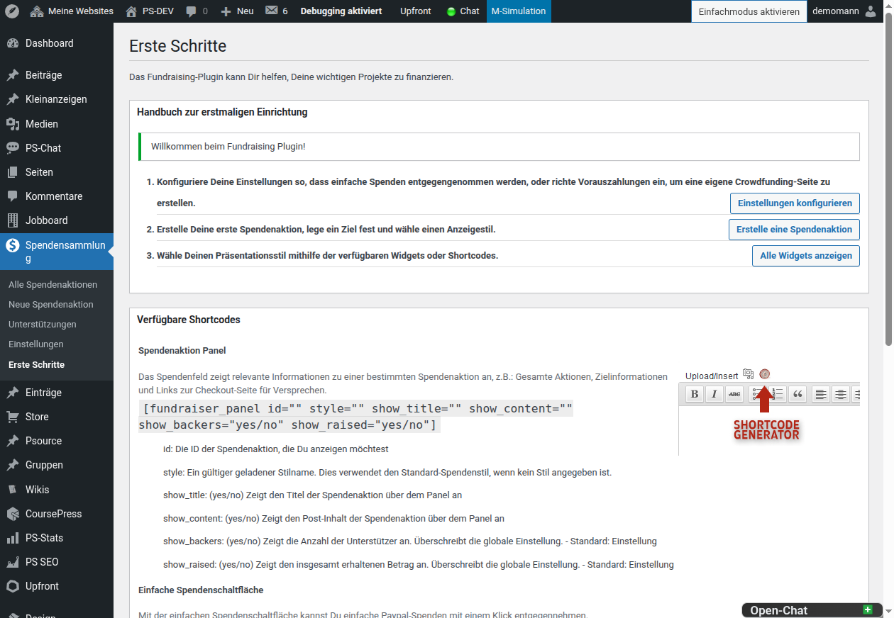
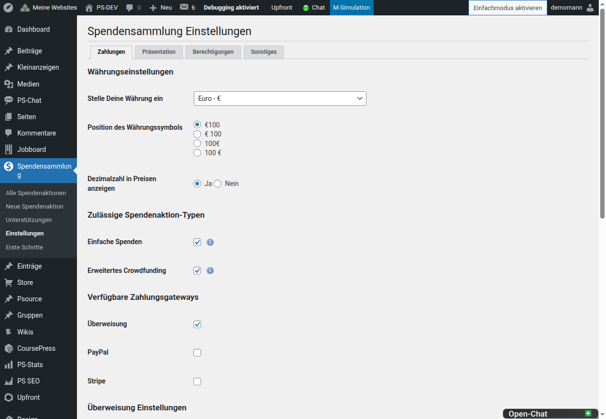
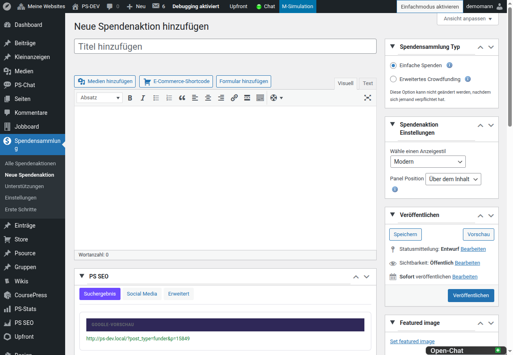

# PS Fundraising – Handbuch

Mit PS Fundraising erstellst Du Spendenaktionen und Crowdfunding-Kampagnen
direkt in ClassicPress oder WordPress. Dieses Handbuch beschreibt die
Einrichtung, die tägliche Verwaltung und die Einbindung auf Deiner Website.



## Voraussetzungen und Installation

- ClassicPress 2.7 oder neuer oder WordPress 4.9 oder neuer
- PHP 8.0 oder neuer
- Für Online-Zahlungen ein eingerichtetes PayPal- oder Stripe-Konto
- Für einen SEPA-QR-Code bei Überweisungen die PHP-Erweiterung `mbstring`

Installiere das Plugin über **Plugins → Installieren** oder kopiere den Ordner
`ps-fundraising` nach `wp-content/plugins/`. Aktiviere es anschließend unter
**Plugins**. Der Menüpunkt **Fundraising** erscheint danach im Backend.

## Schnellstart

1. Öffne **Fundraising → Einstellungen**.
2. Konfiguriere mindestens eine Zahlungsart.
3. Öffne **Fundraising → Spendenaktion erstellen** und lege die erste
   Kampagne an.
4. Veröffentliche die Kampagne.
5. Füge sie mit einem Shortcode in eine Seite oder einen Beitrag ein.

Die Seite **Fundraising → Erste Schritte** fasst diesen Ablauf im Backend
zusammen und zeigt die verfügbaren Shortcodes.

## Einstellungen und Zahlungsarten

Öffne **Fundraising → Einstellungen**, bevor Du eine Kampagne veröffentlichst.
Dort legst Du unter anderem Währung, Permalinks, E-Mail-Texte, Darstellung,
Zahlungsarten und Berechtigungen fest.



### PayPal und Stripe

Aktiviere nur Zahlungsarten, die Du vollständig eingerichtet hast. Hinterlege
die erforderlichen Zugangsdaten ausschließlich in den zugehörigen
Gateway-Einstellungen und teste den Zahlungsablauf vor dem Livegang mit einer
kleinen Testspende.

### Überweisung und manuelle Zahlungen

Für Überweisungen hinterlegst Du Kontoinhaber und IBAN; BIC und Bankname sind
optional. Ein Verwendungszweck-Präfix wird um eine eindeutige Referenz zur
jeweiligen Unterstützung ergänzt.

Bei EUR-Beträgen kann die Bestätigungsseite einen EPC-/SEPA-QR-Code anzeigen,
wenn Kontoinhaber und eine gültige IBAN vorhanden sind. Überweisungen bleiben
zunächst **Ausstehend**. Setze sie erst nach dem tatsächlichen Zahlungseingang
auf **Komplett**.

### Darstellung

Unter **Präsentation → Benutzerdefinierte CSS** kannst Du das Kampagnendesign
anpassen. Beispiel:

```css
.wdf-modern {
    --wdf-modern-primary: #176b5b;
    --wdf-modern-primary-hover: #105347;
    --wdf-modern-surface: #ffffff;
    --wdf-modern-radius: 16px;
}
```

## Spendenaktion erstellen

Öffne **Fundraising → Spendenaktion erstellen**, vergib einen eindeutigen
Titel und ergänze die Beschreibung. Im rechten Bereich des
Bearbeitungsbildschirms stellst Du die kampagnenspezifischen Optionen ein.



### Kampagnentyp wählen

- **Einfache Spenden:** Für fortlaufende Spenden ohne Ziel oder Belohnungen.
  Ein Ziel kann optional festgelegt werden.
- **Erweitertes Crowdfunding:** Für zeitlich und finanziell definierte
  Kampagnen mit Zielbetrag und Belohnungen. Der Zielbetrag ist erforderlich.

Lege bei Crowdfunding-Kampagnen Start- und Enddatum, Zielbetrag sowie bei
Bedarf Belohnungsstufen fest. Wiederkehrende Spenden lassen sich nur
aktivieren, wenn sie zu Zahlungsart und Kampagnenkonzept passen.

Veröffentliche die Kampagne erst, wenn alle Zahlungswege, Texte und
Kampagnenbedingungen geprüft sind.

## Unterstützungen verwalten

Unter **Fundraising → Unterstützungen** findest Du die eingegangenen
Unterstützungen. Eine Unterstützung kann diese Status haben:

| Status | Bedeutung |
| --- | --- |
| **Ausstehend** | Zahlung oder manuelle Prüfung ist noch offen. |
| **Komplett** | Zahlung ist abgeschlossen und darf als Einnahme zählen. |
| **Genehmigt** | Unterstützung ist autorisiert. |
| **Rückerstattet** | Betrag wurde zurückgezahlt. |
| **Storniert** | Unterstützung wurde abgebrochen. |

Für manuell eingetragene Zahlungen wählst Du die zugehörige Spendenaktion,
Name, E-Mail-Adresse, Betrag und Zahlungsquelle. Ändere einen Status nur,
wenn der Zahlungsanbieter oder der eigene Zahlungseingang ihn bestätigt.

## Kampagnen einbinden

Du kannst Kampagnen über Shortcodes, Widgets oder Theme-Vorlagen einbinden.

### Shortcodes

Eine bestimmte Kampagne anzeigen:

```text
[fundraiser_panel id="123"]
```

Titel, Beschreibung, Unterstützerzahl oder Betrag steuern:

```text
[fundraiser_panel id="123" show_title="yes" show_content="yes" show_backers="yes" show_raised="yes"]
```

Unterstützungen einer Kampagne ausgeben:

```text
[pledges_panel id="123"]
```

Eine Fortschrittsanzeige ausgeben:

```text
[progress_bar id="123" show_title="yes" show_totals="yes"]
```

Einen einfachen Spendenbutton ausgeben:

```text
[donate_button]
```

Die `id` ist die Beitrags-ID der Spendenaktion. Du findest sie in der
URL der Bearbeitungsseite oder in der Spaltenansicht unter
**Fundraising → Alle Spendenaktionen**.

### Widgets und Theme-Vorlagen

Unter **Design → Widgets** stehen Fundraising-Widgets für Kampagnen,
Kampagnenlisten, Unterstützungen, aktuelle Spendenaktionen und einfache
Spenden bereit.

Für eigene Theme-Vorlagen unterstützt das Plugin unter anderem diese
Dateinamen im aktiven Theme:

```text
wdf_funder-{ID}.php
wdf_funder-{slug}.php
wdf_funder.php
wdf_checkout-{ID}.php
wdf_checkout-{slug}.php
wdf_checkout.php
wdf_confirm-{ID}.php
wdf_confirm-{slug}.php
wdf_confirm.php
```

## Single-Site und Multisite

### Single-Site

In einer normalen ClassicPress- oder WordPress-Installation verwaltest Du
Kampagnen, Unterstützungen und Einstellungen direkt unter **Fundraising**.
Die Einstellungen gelten für diese Website.

### Multisite

Das Plugin kann netzwerkweit aktiviert oder als MU-Plugin bereitgestellt
werden. Aktiviere es in der Netzwerkverwaltung nur dann netzwerkweit, wenn
alle Unterwebsites Fundraising verwenden sollen. Prüfe anschließend auf jeder
Unterwebsite die lokalen Fundraising-Einstellungen, Zahlungsdaten und
Permalinks.

Die Netzwerkverwaltung enthält unter **Einstellungen → Donations** eine
Netzwerkseite. Sie stellt derzeit keine zusätzlichen konfigurierbaren
Fundraising-Optionen bereit; Kampagnen- und Zahlungs-Einstellungen werden
pro Unterwebsite verwaltet.

> **Wichtig:** Verwende in einem Netzwerk nicht dieselben Zahlungszugänge auf
> mehreren Unterwebsites, wenn Buchhaltung, Verwendungszwecke oder
> Datenschutzinformationen getrennt bleiben müssen.

## Checkliste vor dem Livegang

- Mindestens eine Zahlungsart ist vollständig eingerichtet und getestet.
- Texte, Zielbetrag, Laufzeit und Belohnungen der Kampagne sind geprüft.
- Überweisungsdaten und der Verwendungszweck sind korrekt.
- Die Bestätigungsseite und alle E-Mail-Texte enthalten die notwendigen
  Informationen.
- Ein Test über den tatsächlichen Einbindungsweg, etwa über einen Shortcode,
  wurde durchgeführt.
- Berechtigungen erlauben nur den vorgesehenen Personen, Einstellungen und
  Unterstützungsstatus zu ändern.
